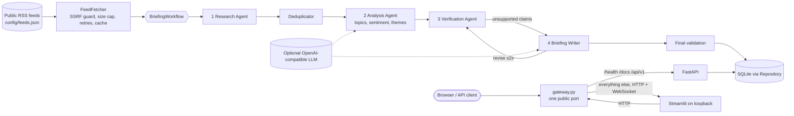
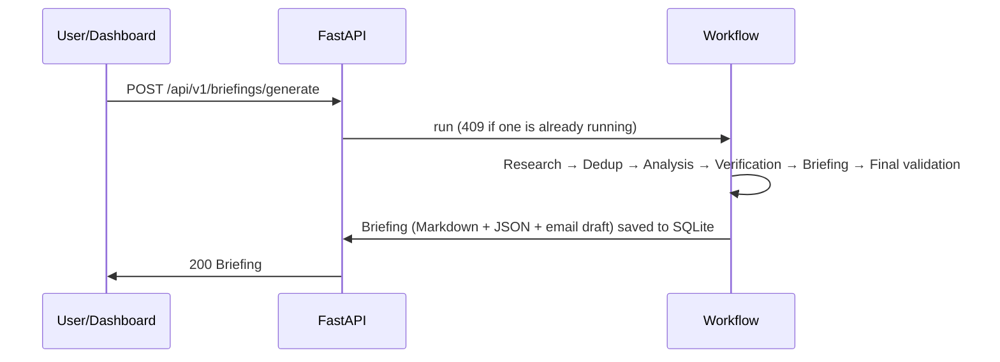

# Autonomous Market Intelligence Agent

A multi-agent pipeline that turns public financial/business RSS news into a **source-grounded daily market briefing**, exposed through a FastAPI REST API and a Streamlit dashboard. It works **with no paid API and no LLM** (deterministic fallback), and can optionally add LLM-written summaries.

> Sentiment scores are analytical signals, **not** market forecasts or investment recommendations.

**Live demo:** _not deployed yet — add your Render URL here after step 10 of [Render deployment](#render-deployment)._

## Problem
Analysts and builders skim dozens of headlines a day. Summaries from a single chatbot call can hallucinate numbers or quotes. This project shows a safer pattern: retrieve → deduplicate → analyse → **verify every claim against retrieved sources** → write.

## Solution and architecture





## The four agents
| Agent | Responsibility |
|---|---|
| News Research | Fetch configured RSS feeds, normalise title/publisher/date/summary/URL, reject malformed entries, tolerate dead feeds, record collection time |
| Trend & Sentiment Analyst | Keyword topic tagging, rule-based sentiment baseline, recurring-term themes with evidence URLs; optional LLM interpretation labelled *speculative* |
| Verification & QC | Checks every claim against cited articles; flags unsupported, single-source, stale and undated claims; only multi-publisher claims may be called "corroborated"; sends drafts back for revision (≤2 loops) |
| Briefing Writer | Executive summary, key developments (with "why it may matter"), themes, sentiment, risks, uncertainties, source list; Markdown + JSON + an email draft (**never sent**) |

**Orchestration note:** the spec allowed CrewAI or LangGraph. I implemented a small explicit sequential pipeline instead (`app/workflows/briefing_workflow.py`) because CrewAI/LangGraph add large dependency trees that are risky on Render's 512 MB free instance and the flow here is strictly linear. Swapping in LangGraph later is straightforward since each agent is a plain class.

## Tech stack
Python 3.11+, FastAPI, Pydantic v2, Streamlit, Pandas, Requests, defusedxml, SQLite, Pytest, Ruff, Docker, GitHub Actions, Render. Sentiment is a built-in, dependency-free lexicon baseline (VADER-inspired, **not** the VADER package).

## Features
- Topic-tagged feed list in `config/feeds.json` (18 public feeds incl. Fed, ECB, EIA); only feeds relevant to the chosen topics are fetched, capped by `MAX_FEEDS_PER_RUN`
- RSS ingestion with timeouts, bounded retries + backoff, in-memory cache, article caps, size caps, SSRF-safe URL validation (including redirects)
- Dedup by normalised URL and headline similarity
- Two modes: **Free/no-LLM** (default) and **Optional LLM** (any OpenAI-compatible endpoint)
- LLM guardrails: untrusted text sits in a delimited data block, suspicious articles are excluded, output containing numbers/URLs absent from the sources is discarded
- REST API with validation, rate limiting, request-size limit, single-job lock (409), safe error messages
- SQLite repository (replaceable), corrupt-record tolerance, repeatable init
- One public port: the REST API and `/docs` are served directly; the dashboard is reverse-proxied (HTTP + WebSocket) by `gateway.py`
- Dashboard: health, generate button, topic/date selectors, article cards, charts, themes + evidence, agent progress, history, Markdown/JSON downloads

## Screenshots
Add your own genuine screenshots to `docs/screenshots/` after running the app, then reference them here:
```md

```
(No screenshots are included because none have been captured from a running deployment.)

## Install and run locally

**macOS / Linux**
```bash
python3 -m venv .venv && source .venv/bin/activate
pip install -r requirements-dev.txt
cp .env.example .env
python start.py            # dashboard http://localhost:8000  ·  API docs http://localhost:8000/docs
```
**Windows (PowerShell)**
```powershell
py -3.11 -m venv .venv; .venv\Scripts\Activate.ps1
pip install -r requirements-dev.txt
copy .env.example .env
python start.py
```
Other modes via `MODE`: `api` (API only), `dashboard` (Streamlit only, needs `API_BASE_URL`), `both` (API on :8000 and Streamlit on `$PORT` as two ports). Windows PowerShell: `$env:MODE="api"; python start.py`.

## Configuring news feeds
Edit `config/feeds.json` (name, url, optional `topics` hints, `enabled`). Invalid, duplicate or non-http(s) entries are skipped. `FEEDS="Name|https://url,Name2|https://url2"` overrides the file. The feed URLs shipped here were written from memory and **could not be checked from my build environment**; dead feeds are tolerated and shown as "Feed unavailable" in the briefing, but remove any that fail for you.

## Environment (`.env`)
Everything is optional; with no LLM configured the app uses the free deterministic fallback. See `.env.example`.

## Gemini LLM mode (free tier)
1. Create an API key in [Google AI Studio](https://aistudio.google.com/apikey) (the free tier needs no billing, in eligible countries).
2. Set `LLM_PROVIDER=gemini` and `GEMINI_API_KEY=<key>` in `.env` (locally) or as secret env vars on Render. Pick a free-tier-eligible `LLM_MODEL` for your project.
3. Run the app, tick **Use LLM if configured** in the dashboard (or send `"use_llm": true` to the API). The briefing's mode label then reads LLM-assisted; if anything fails it falls back to the deterministic text.

What the LLM does here: writes a two-sentence overview and one-sentence interpretations per theme. What it never does: supply facts. Key developments are always extractive headlines checked by the verification agent, and LLM text containing numbers or URLs not found in the retrieved articles is discarded.

Free-tier protections: calls are spaced (`LLM_MIN_INTERVAL_S`), capped per UTC day (`LLM_DAILY_CALL_BUDGET`, retries count), 429/5xx are retried with bounded backoff honouring `Retry-After`, and 401/403/400 are never retried. One briefing uses about two LLM calls. Google states that limits are per project, vary by model and are not guaranteed, and that free-tier content may be used to improve its products, so only public news text is sent and you should check the current terms in AI Studio.

## Daily automation (persistent history for free)
`.github/workflows/daily-briefing.yml` runs `scripts/run_briefing.py` every day, writes `briefings/YYYY-MM-DD.md|json` and `briefings/latest.md`, and commits them. This sidesteps Render's ephemeral disk. Add the repository secret `GEMINI_API_KEY` for Gemini mode (otherwise it uses the fallback). GitHub may disable scheduled workflows on inactive public repos, so check the Actions tab occasionally.

## Evaluation (numbers you can honestly quote)
`python scripts/evaluate.py --write` runs the pipeline and writes `docs/EVAL.md`; `--live` uses real feeds; `--labels file.csv` scores the sentiment baseline. The shipped label file is author-written and illustrative only: on it the baseline scored 86.7% (26/30). Do not quote that as a benchmark. Label real headlines yourself (ideally with a second person) and quote that result with its sample size.

## API examples
```bash
# default local port is 8000 (or your Render URL)
curl localhost:8000/health
curl -X POST localhost:8000/api/v1/briefings/generate -H 'content-type: application/json' \
     -d '{"topics":["ai","markets"],"days":2}'
curl localhost:8000/api/v1/briefings/latest
curl "localhost:8000/api/v1/news?topic=ai&page=1&page_size=10"
curl localhost:8000/api/v1/analytics
curl localhost:8000/api/v1/agents/status
curl localhost:8000/api/v1/feeds
```
Endpoints: `GET /health`, `GET /` (API info; in gateway mode `/` is the dashboard), `GET /docs`, `GET /api/v1/feeds`, `POST /api/v1/briefings/generate`, `GET /api/v1/briefings/latest|history|{id}`, `GET /api/v1/news`, `GET /api/v1/analytics`, `GET /api/v1/agents/status`.

## Sample briefing
[`sample_data/sample_briefing.md`](sample_data/sample_briefing.md) — generated by `python scripts/generate_sample.py` from **fictional** articles (labelled SAMPLE DATA). It demonstrates format only.

## Testing
```bash
pytest            # network-free: mocked feeds, fake LLM
ruff check .
```
Covers (including the Gemini client's retry/quota logic, the gateway, with a mocked upstream and a fake WebSocket, and feed-config parsing/selection): health, RSS/Atom parsing, malformed entries, XML entity bombs, duplicates, empty feeds, timeouts, SSRF/redirects, sentiment, themes, claim verification (unsupported/single-source/stale/undated), missing LLM credentials, deterministic fallback, fake-LLM mode, hallucinated-number rejection, prompt-injection exclusion, concurrency lock, rate limiting, API error sanitising.

**Test results:** _paste the output of your own `pytest` run here._ (The author's build environment had no network, so the full suite — which needs FastAPI/pytest/httpx — had not been executed there when this was packaged, and the gateway has never been exercised against a live Streamlit server. Don't claim a pass until CI is green and you've opened the deployed dashboard.)

## Docker
```bash
docker compose up --build      # dashboard http://localhost:8000, API docs http://localhost:8000/docs
```
The compose file mounts a named volume so SQLite history persists locally.

## Render deployment
Architecture: **one free web service, one public port.** `python start.py` runs Streamlit on loopback and `gateway.py` on Render's `$PORT`. The gateway serves the REST API itself (`/health`, `/docs`, `/api/v1/...`) and reverse-proxies every other path, including Streamlit's WebSocket (`/_stcore/stream`), to the dashboard. So one URL gives you both: `https://<service>.onrender.com/` is the dashboard and `https://<service>.onrender.com/docs` is the API. Note that in this mode `/` is the dashboard, not the API info JSON.

Trade-offs: Streamlit's CORS/XSRF checks are switched off in this mode (they would reject the proxied browser origin); Streamlit is bound to loopback only and the app has no logins or uploads. Dashboard calls reach the API from 127.0.0.1, so all dashboard users share one rate-limit bucket; direct API clients are limited per IP when `TRUST_PROXY=true` (verify `PROXY_HOPS` for your setup, default 1).

1. Create a GitHub repository (empty, no README).
2. Push the project (commands below).
3. Sign in at render.com with GitHub.
4. **New → Blueprint** → pick the repo (it reads `render.yaml`), or **New → Web Service** and use Build `pip install -r requirements.txt`, Start `python start.py`.
5. Choose the **Free** instance type.
6. Environment variables: defaults are in `render.yaml`. Add `LLM_PROVIDER=openai_compatible` + `LLM_API_KEY` only if you want LLM mode (mark the key secret).
7. Deploy.
8. Open the `onrender.com` URL → dashboard; `/health` is the health check and `/docs` the API docs.
9. Logs tab: typical failures are a wrong Python version (set `PYTHON_VERSION=3.11.9`), a missing dependency, a dashboard that shows "unavailable" (Streamlit failed to start — see logs; the gateway answers 502 meanwhile).
10. Put the live URL at the top of this README and commit.

```bash
git init && git add . && git commit -m "Initial commit: Autonomous Market Intelligence Agent"
git branch -M main
git remote add origin https://github.com/<you>/autonomous-market-intelligence-agent.git
git push -u origin main
```

## Free-tier limitations (as documented by Render at time of writing — re-check)
Free web services spin down after 15 minutes without traffic and take about a minute to wake; they have 512 MB RAM and 0.1 CPU, 750 free instance-hours per month, an **ephemeral filesystem** (SQLite history is lost on redeploy/restart/spin-down) and may be restarted at any time. Use the Markdown/JSON download buttons to keep reports. Also consider that a first generation run on 0.1 CPU can take a minute.

## Security considerations
Env-only secrets (never logged or returned), SSRF-validated feed URLs incl. redirects, `defusedxml`, response-size caps, bounded retries, per-IP rate limits, request-size limit, input validation, no shell execution or open-ended tool use, untrusted text kept apart from LLM instructions, grounded-output checks, safe error messages. Known limits: the gateway/WebSocket proxy has not been run against a real Streamlit server (see Testing); the rate limiter is in-memory and per-instance; it keys on the direct client IP (behind a proxy this may be the proxy's IP); the public dashboard has no authentication.

## Source attribution and copyright
Every item links to its publisher. Reports contain headlines and short extracts only — never full articles. Check each publisher's RSS terms before deploying publicly. Default feeds: BBC, NYT, The Guardian, CNBC, MarketWatch (configurable via `FEEDS`); feed availability is not guaranteed.

## Future enhancements
PostgreSQL repository, scheduled generation (needs a paid cron or external scheduler), embeddings-based clustering, per-feed health dashboard, auth, LangGraph orchestration.

## License
MIT — see [LICENSE](LICENSE) (replace `<YOUR NAME>`).
